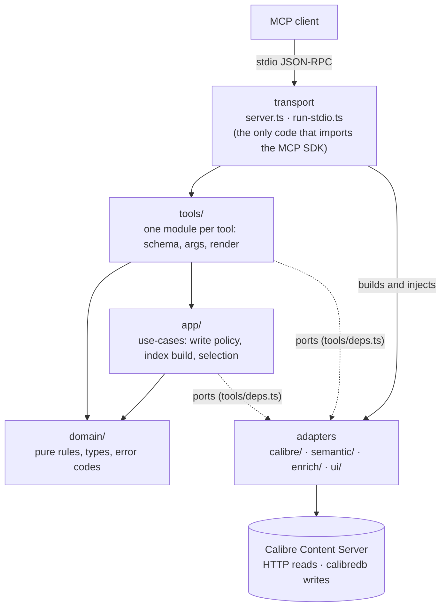

# Architecture

How calibre-mcp is built, which rules hold it together and why, and the main decisions with their trade-offs.
It is meant as a ten-minute read: details live in the code and in [`docs/standards/`](standards/), linked from
each section. Terms follow the [glossary](../GLOSSARY.md).

## Shape

calibre-mcp is an MCP server, spoken to over **stdio**, that sits between an MCP client (Claude Desktop, Claude
Code, …) and a running Calibre. It works on two surfaces:

- **the library**: search, metadata, tags, bulk edits, duplicates, quality audits, metadata recovery, bundles;
- **a single book**: its content (whole or in chunks), chapter map, figures, and search inside it.

Semantic search spans both through a `scope: library | book` parameter instead of separate tools. The tool list
is in [`TOOLS.md`](TOOLS.md).

Calibre is reached in two ways only: reads over the Content Server's HTTP API, writes through `calibredb`
routed to that same running server. Nothing opens the library's database directly.

### Layers

The dependency rule points inward:

- **`domain/`** imports only itself (and ambient type declarations): no I/O, no adapters, no MCP types.
- **`app/`** holds the use-cases. It sees `domain/` and the port interfaces in
  [`tools/deps.ts`](../src/tools/deps.ts), never concrete adapters, tool modules, MCP result types or UI.
- **`tools/`** holds thin adapters from MCP to the use-cases: a Zod schema, argument resolution, one call into
  `app/` or `domain/`, and rendering of the result. Tool code and schemas never import the MCP SDK; they use a
  small hand-written mirror of the result types ([`tools/types.ts`](../src/tools/types.ts)).
- **The transport layer** ([`server.ts`](../src/server.ts), [`run-stdio.ts`](../src/run-stdio.ts)) is the only
  code that touches the SDK and the only composition root: it builds the adapters and registers every tool.

These directions are not a convention: [`test/architecture.test.ts`](../test/architecture.test.ts) parses every
import and fails CI on a forbidden edge, an SDK import outside the transport, or a tool or use-case constructing
its own adapter. The rules behind it are in [`standards/architecture.md`](standards/architecture.md).

## Invariants, and why they exist

Each of these came from a concrete failure or risk; each is enforced by a test, a lint rule or one shared module.

**Writes are gated by two keys and are preview-first.** A master switch (`CALIBRE_MCP_ENABLE_WRITE`, read in
[`config.ts`](../src/config.ts)) gates writes per call: with it off, [`tools/write-gate.ts`](../src/tools/write-gate.ts)
refuses each Write call with `write_disabled`, keeps preview-first tools listed, and hides write tools with no
preview. Each tool also
declares its own annotations (read-only, destructive, idempotent) for the client. Destructive and bulk tools
preview by default and act only on an explicit `confirm` / `preview: false` / `apply`; a preview is a success
result, not an error. A tool that takes a filesystem path checks it against an allow-list of roots
([`tools/add-path.ts`](../src/tools/add-path.ts)). See [`standards/writes.md`](standards/writes.md).

**Writes go through the running Content Server.** With the Calibre GUI open, direct database access is refused
or races the GUI. Every `calibredb` call is routed with `--with-library <server URL>#<library id>`
([`calibre/client.ts`](../src/calibre/client.ts)). The server needs a library **id**, not its display name, so
every call first resolves the name through the server's own library map.

**A committed write is never reported as failed.** A routed write commits on the server before `calibredb`
answers, so a timeout or a connection dropped mid-request says nothing about the outcome. Those cases are settled
by re-reading the book: confirmed → success, unconfirmed → the result steers to `calibre_get_book`. One module
decides that mapping, [`app/write-policy.ts`](../src/app/write-policy.ts), and [`tools/write-failure.ts`](../src/tools/write-failure.ts)
renders it (code, text and next step) for every write tool. Only
idempotent metadata writes are retried, and a timeout never is.

**Channel parity.** A tool result has a text channel and a structured channel, and clients disagree on which one
the model sees: some show only the text, some only `structuredContent`. Anything the model must act on (ranked
hits, excerpts, cursors, error codes) appears in both. Widgets fetch their own data for the same reason (see
decision 9). See [`standards/results-and-errors.md`](standards/results-and-errors.md).

**Return, don't throw, with a closed set of error codes.** Handlers return an error result with an actionable
message instead of throwing. Every error carries one code from a fixed set of 19
([`domain/error-codes.ts`](../src/domain/error-codes.ts)). Its text ends with a labelled `Code:` line and, when
the message does not already spell out the next step, a `Next:` line
([`tools/result.ts`](../src/tools/result.ts)). A test fails any call site that passes a code outside the set.

**The SDK-free seam.** Keeping handlers off the SDK kept the move from MCP SDK v1 to v2 inside the transport files
and the type mirror, and it lets every tool be unit-tested with plain fakes.

**stdout is the protocol.** On stdio a single stray `console.log` corrupts the JSON-RPC stream. oxlint bans
`console` in `src/`; logging goes to stderr and an optional file through [`logging.ts`](../src/logging.ts).

**Inputs are coerced, not trusted.** Some clients send numbers, arrays and booleans as strings. Every schema
coerces them ([`tools/coerce.ts`](../src/tools/coerce.ts)), and booleans use a safe parser because a naive
coercion reads the string `"false"` as `true`.

## Semantic search

The pipeline is described for users in [`SEMANTIC-SEARCH.md`](SEMANTIC-SEARCH.md). In short:

1. **Extract** text: download the book file from the Content Server and convert it to plain text
   (`pdftotext` or PyMuPDF for PDFs when installed, Calibre's `ebook-convert` otherwise), keeping page and
   chapter positions ([`calibre/extract.ts`](../src/calibre/extract.ts)).
2. **Chunk** it into passages of about 460 tokens, split along headings where possible; chunks in
   front matter are flagged.
3. **Embed** each chunk with `multilingual-e5-small` and store the vectors as BLOBs in a local SQLite file
   (`node:sqlite`), next to an FTS5 keyword index with English and Russian stemming.
4. **Retrieve** with two halves: cosine similarity over every chunk vector (top 50) and a stemmed BM25 match
   (top 50), fused by Reciprocal Rank Fusion (k = 60, equal weights)
   ([`semantic/retrieve.ts`](../src/semantic/retrieve.ts), [`semantic/fusion.ts`](../src/semantic/fusion.ts)).
5. **Rerank** the top 30 fused candidates with a cross-encoder (`bge-reranker-v2-m3`) when that optional model is
   present. When even the best reranked hit scores below a confidence floor of 0.3, the result is flagged as a
   weak match instead of being presented as an answer ([`semantic/reranker.ts`](../src/semantic/reranker.ts)).

Figure captions are indexed and searched the same way.

**How it is evaluated.** [`test/eval/`](../test/eval/README.md) runs labelled golden queries over a committed
fixture corpus through the real index build and the real search handler, and scores Hit@1, Recall@5, MRR and
nDCG@10 per query kind and mode. Every tuning question (reranker on or off, fusion weights, the embedding model,
the confidence floor) is settled against gates written into `thresholds.json` **before** the measurement runs; a
change that passes no declared gate is not shipped. A gated run also requires every baseline query to reproduce
its top-10 list exactly, so an unintended ranking change shows up as a diff rather than as a small drop in an
average.

## Key decisions

The project records decisions as numbered ids (`D-NNN`) cited in code comments; the ones that appear in public
files are listed under [Decision ids](#decision-ids).

1. **A small multilingual embedding model** (D-001, D-012). `multilingual-e5-small` runs on CPU, has 384
   dimensions, and handles English and Russian queries against books in either language. Larger candidates
   (EmbeddingGemma-300M, bge-m3) were measured on the eval suite and did not earn their size and index rebuild.
   *Trade-off:* a lower ceiling than a large English-only model, in exchange for local, fast, cross-lingual
   search.

2. **Brute-force vectors in SQLite, hybrid retrieval, plain RRF** (D-010, D-021). No vector database and no
   native dependency: vectors live as BLOBs in `node:sqlite` and every query scans them. Vector and keyword
   results are fused by rank, so their scores never need normalizing. A sweep of weighted fusion passed no gate
   declared beforehand, so the weights stay equal. *Trade-off:* a linear scan per query, which is fine at the
   size of a personal library and keeps installation to `npx`.

3. **A cross-encoder rerank stage with a confidence floor** (D-011, D-022). Reranking fixes most cases where
   fusion puts a near-miss first, and the floor lets the server say "nothing relevant" instead of returning the
   nearest neighbour. *Trade-off:* a ~576 MB optional download and seconds of CPU per search. Rerank calls run
   one at a time, and a search that would queue behind several others skips rerank and says so.

4. **In-band preview and confirm instead of MCP elicitation** (D-003). Writes take `confirm` / `preview` /
   `apply` parameters rather than asking the client for confirmation through the protocol. This works in every
   client and keeps handlers SDK-free. *Trade-off:* the safety step relies on the model showing the preview to the
   user; the server cannot force a dialog.

5. **About twenty intent-level tools** (D-005). Model tool-selection gets worse as similar tools pile up, so
   related `calibredb` subcommands fold into task tools (one `calibre_recover_metadata`, not three chained calls)
   and the CLI is not mirrored one-to-one. Today there are 19 model-facing tools plus 2 that only widgets call.
   *Trade-off:* richer per-tool schemas and descriptions, which a catalog lint keeps distinct
   ([`test/eval/catalog-lint.ts`](../test/eval/catalog-lint.ts)).

6. **Library ids resolved through the server, every time** (D-008). `calibredb` addresses a library by id, and a
   display name fails. Every call resolves the caller's name or id through the server's library map, and an
   unknown name fails with the list of known libraries instead of guessing an id. *Trade-off:* one cached
   lookup per process, refreshed once when a name misses.

7. **Bundles are backed by saved searches; no virtual-library writes** (D-019). A bundle (a named topical
   filter that scopes a search) is stored as a Calibre saved search, and so is an exclusion marker (a saved
   search named with a leading `-`, subtracted from every discovery search). Writing
   virtual libraries had no safe path while the GUI holds the library. *Trade-off:* bundles do not appear as
   virtual libraries in the GUI. Newer Calibre versions expose virtual-library commands; whether those writes are
   safe with the GUI open has not been checked, so the decision stands.

8. **The figure is a captioned image** (D-018). Books embed many images that are not figures (chapter art,
   logos), and size thresholds do not separate them. A figure is an image the text refers to, identified by an
   adjacent caption; captions are matched by a fixed set of patterns, not user regex. Figures drawn as vectors
   have no embedded image, so they are produced by rendering the page. *Trade-off:* an uncaptioned image is
   invisible to `calibre_get_figures`.

9. **Widgets fetch their own data when the result can't carry it** (D-017). The cover board, book card and
   figures widget are MCP Apps. Some hosts strip `structuredContent` before it reaches a widget, and re-running a
   semantic search costs seconds. So the cover board pulls its rows through a widget-only tool
   (`calibre_board_data`), and the book card re-reads its book with `calibre_get_book`. The figures widget needs no
   call: it renders the image and text blocks of the tool result itself, which hosts pass through intact.
   *Trade-off:* an extra call per board or card, and a tool the model never sees.

10. **Clean-room and permissive next to GPL Calibre** (D-004). calibre-mcp is MIT. It uses Calibre only as a program
    (the Content Server API, `calibredb`, `ebook-convert`), which does not carry Calibre's GPL over. Algorithms
    such as ISBN checksums or duplicate detection are written from public descriptions and observed behaviour, not
    translated from Calibre's or its plugins' GPL source. *Trade-off:* some logic that exists in Calibre is
    written twice.

## Deliberately not there

- **OCR.** Calibre has none, and neither does this server. A scanned PDF extracts to empty text.
- **Page-level Calibre full-text search.** Calibre's FTS answers which books match, not where. Locations (page,
  chapter, character offset) come from the semantic index, which is built from extracted text.
- **Conversion and export tools.** `ebook-convert` and `calibredb export` stay command-line operations
  (routed through the Content Server); the bundled skill documents them as the escape hatch instead of the server
  wrapping them in more tools.
- **Direct database access.** No SQLite reads or writes against `metadata.db`, for the GUI-concurrency reason
  above.
- **Network transport.** The server speaks stdio to one local client; there is no HTTP endpoint and no
  multi-user auth.

## Decision ids

Ids cited in public code, tests and standards, one line each.

| Id    | Decision                                                                                                    |
| ----- | ----------------------------------------------------------------------------------------------------------- |
| D-001 | The embedding model is `multilingual-e5-small`.                                                             |
| D-003 | Writes confirm through in-band `preview` / `confirm` / `apply` parameters, not MCP elicitation.             |
| D-004 | The server is MIT and clean-room: Calibre is used as a program, and its GPL source is read for contracts only. |
| D-005 | Tools are few and intent-level (about twenty); `calibredb` subcommands fold into task tools.                |
| D-006 | Distribution: npm (`npx`), a `.mcpb` bundle for Claude Desktop, and the MCP Registry, published by release CI. |
| D-008 | Every `calibredb` call addresses the library by its id, resolved through the Content Server.                |
| D-010 | Semantic stack: transformers.js, brute-force cosine on `node:sqlite` BLOBs, hybrid vector + FTS5 with RRF. |
| D-011 | A cross-encoder reranker (`bge-reranker-v2-m3`) reorders hybrid and vector results.                         |
| D-012 | `multilingual-e5-small` kept after a measured bake-off; set the rule that eval gates are declared before measuring. |
| D-016 | Front-matter chunks are flagged at index time and ranked below body matches in book scope.                  |
| D-017 | MCP Apps widgets (cover board, book card) attach to their tools and pull their data through a widget-only tool. |
| D-018 | A figure is an image identified by an adjacent caption; served by `calibre_get_figures`.                    |
| D-019 | Bundles and exclusion markers are backed by saved searches; no virtual-library writes.                      |
| D-020 | A PDF's outline (bookmarks) is the first source for its chapter map; text heuristics are the fallback.      |
| D-021 | Fusion weights stay equal: a weighted-RRF sweep passed no gate declared before it ran.                      |
| D-022 | The rerank confidence floor stays at 0.3 until a lower value passes a rule declared in advance.            |
